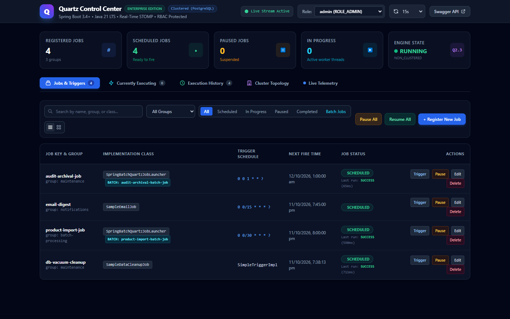
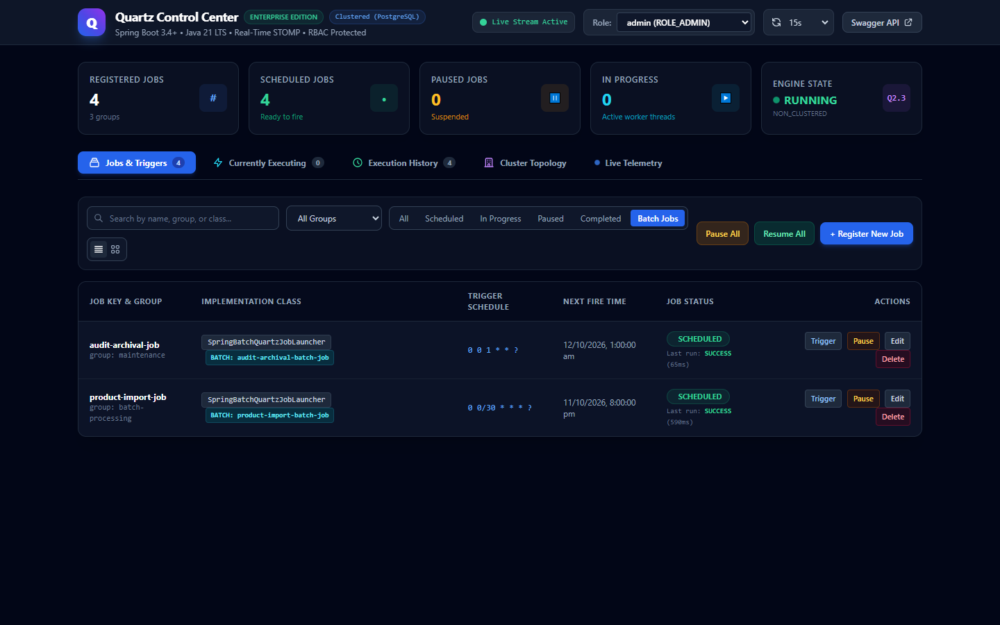
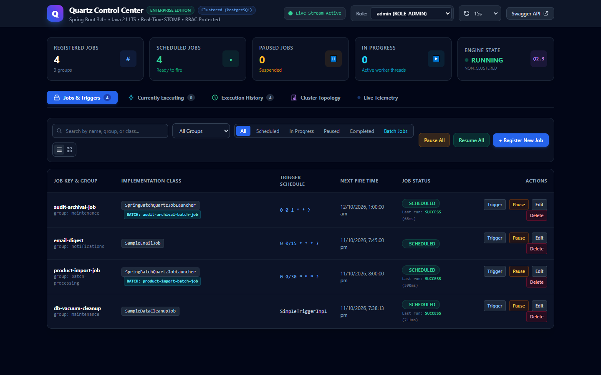
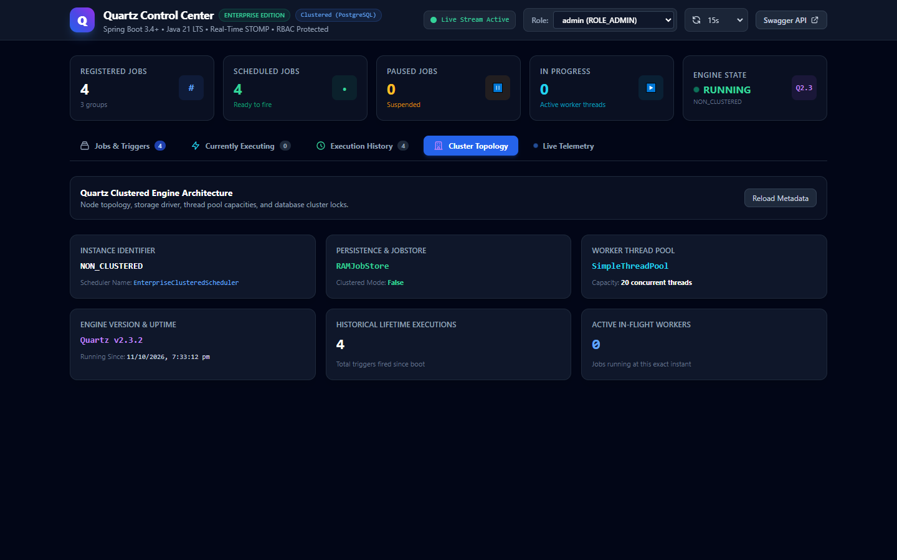
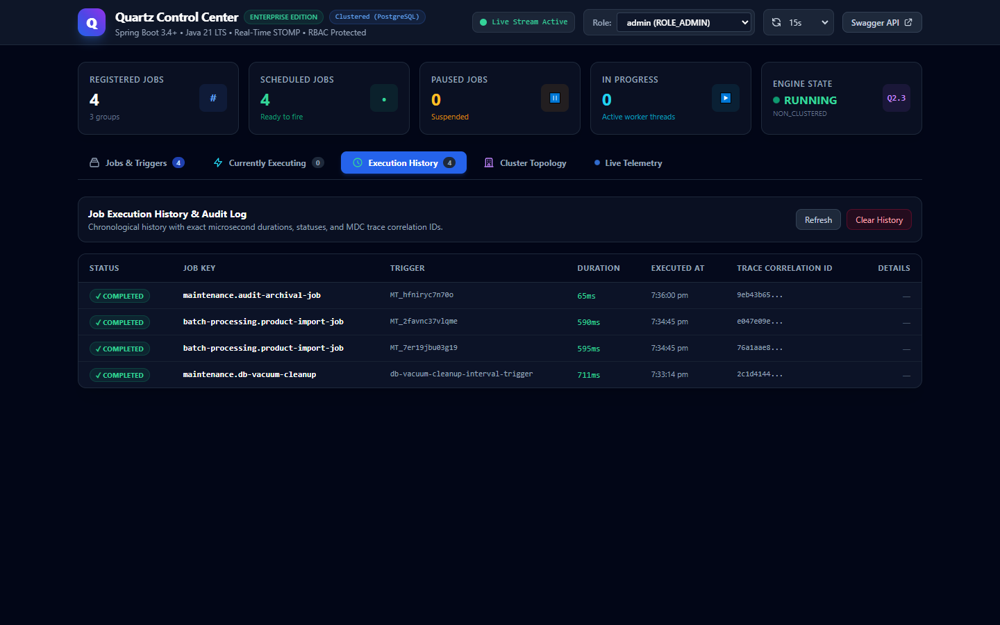

# ⚡ Spring Boot Quartz Enterprise Control Center with Real-Time WebSocket & Spring Batch 5

A production-grade, distributed scheduling microservice and operational control center built on **Spring Boot 3.4+** and **Java 21 LTS**, architected with **Quartz JDBC-JobStore clustering**, **Spring Batch 5.x Chunk & Tasklet ETL pipelines**, **Spring WebSocket (STOMP / SockJS)** live telemetry, and an ultra-responsive, embedded dark-mode operations dashboard.

---

## 🌟 Key Features

* **Distributed Clustered Scheduling:** Quartz `JobStoreCMT` / `LocalDataSourceJobStore` with PostgreSQL row locking (`QRTZ_LOCKS`) guaranteeing single execution across multiple instances.
* **Spring Batch 5.x Integration (Bridge Pattern):**
  - **`SpringBatchQuartzJobLauncher`:** Bridges clustered Quartz triggers to Spring Batch 5 `JobLauncher` and `ListableJobLocator`.
  - **Chunk-Oriented ETL (`product-import-batch-job`):** High-throughput catalog ingestion pipeline with configurable commit interval (10 items), `@StepScope` item reader, business processor (tax calculation & slug generation), and batch item writer.
  - **Tasklet Workflows (`audit-archival-batch-job`):** Single-step partition cleanup and cold-storage compliance log archival.
  - **MDC Correlation Propagation:** Quartz correlation IDs and execution parameters seamlessly inject into typed Spring Batch `JobParameters`.
  - **Batch Observability (`BatchExecutionLoggingListener`):** Step & Chunk metrics (read count, write count, commit count, filter count, skips) logged with execution durations.
* **Modern Embedded UI Dashboard (`/dashboard`):**
  - **Zero Database Credential Exposure:** 100% backend REST API & WebSocket driven (no direct client-to-database connections).
  - **Human-Intuitive Operational Statuses:** Clear visual status badges (`IN PROGRESS` with animated pulse, `SCHEDULED`, `PAUSED`, `COMPLETED`, `FAILED`, `BLOCKED`).
  - **Batch Job Preset & Filtering:** Toolbar filter pill (`Batch Jobs`) and modal preset to register batch jobs with auto-filled JSON configurations.
  - **Latest Execution Duration & Telemetry:** Execution durations (ms) and success/failure outcomes attached directly to each job card.
  - **Live WebSocket STOMP Push:** Instant reactive updates on `/topic/job-events` when jobs fire, complete, pause, or resume without polling.
  - **In-Flight Worker Thread Viewer:** Real-time visibility into currently executing jobs across scheduler threads.
  - **Job Execution Audit History:** Chronological log tracking execution start/end times, durations, correlation IDs, and error traces.
  - **Cluster Topology & Metadata:** Instance IDs, thread pool sizes, JobStore class, and total lifetime executions.
  - **Interactive Drawer & Quick Actions:** One-click trigger now with ad-hoc JSON payload, pause/resume, edit cron schedules, and delete.
* **Production-Grade Architecture & Design Patterns:**
  - **Bridge Pattern:** `SpringBatchQuartzJobLauncher` connects Quartz trigger lifecycles to Spring Batch execution engines.
  - **Factory Pattern:** `JobDetailFactory` encapsulates job definition and `JobDataMap` construction.
  - **Strategy Pattern:** `TriggerStrategy` interface with `CronTriggerStrategy`, `SimpleIntervalTriggerStrategy`, and `OneTimeTriggerStrategy`.
  - **Observer / Listener Pattern:** `MdcJobListener` for distributed MDC tracing and `LoggingTriggerListener` for misfire auditing.
  - **Broadcaster Service:** `JobEventBroadcaster` pushing events asynchronously over Spring WebSocket messaging.
* **Role-Based Access Control (RBAC):** Spring Security 6 with `ROLE_ADMIN`, `ROLE_OPERATOR`, and `ROLE_VIEWER`.
* **RFC 7807 Problem Details:** Global exception handling with standardized problem details and MDC correlation IDs.
* **OpenAPI 3 / Swagger Documentation:** Interactive API documentation available at `/swagger-ui.html`.

---

## 📸 Screenshots & UI Showcase

### 1. Operations Control Center (Live Status Telemetry & Seeded Batch Jobs)


### 2. Spring Batch Filtered View


### 3. Slide-Over Job Inspector Drawer (Spring Batch Bridge Parameters)


### 4. Quartz Clustered Engine & Instance Topology


### 5. Job Execution History & Duration Audit Log


---

## 🏗️ System Architecture

```
   ┌────────────────────────────────────────────────────────────────────────┐
   │                          Web Operations UI                             │
   │           http://localhost:8080/dashboard  (Embedded SPA)              │
   └───────────────────▲────────────────────────────────▲───────────────────┘
                       │ HTTP REST (JSON)               │ WebSocket (STOMP)
                       │ /api/v1/jobs                   │ /ws-quartz -> /topic/job-events
                       ▼                                │
   ┌────────────────────────────────────────────────────┴───────────────────┐
   │                  Spring Boot 3.4+ Backend Microservice                 │
   │                                                                        │
   │   ┌─────────────────────┐  ┌─────────────────────┐  ┌──────────────┐   │
   │   │  Job Management API │  │ Quartz Clustered    │  │ WebSocket    │   │
   │   │  (Spring Security)  │  │ Scheduler Engine    │  │ Broadcaster  │   │
   │   └──────────┬──────────┘  └──────────┬──────────┘  └──────▲───────┘   │
   │              │                        │                    │           │
   │              │                        ▼                    │           │
   │              │             ┌─────────────────────┐         │           │
   │              │             │ Quartz Listeners    ├─────────┘           │
   │              │             │ (MdcJobListener)    │                     │
   │              │             └──────────┬──────────┘                     │
   │              │                        │                                │
   │              │                        ▼ (Bridge Pattern)               │
   │              │             ┌─────────────────────┐                     │
   │              │             │ SpringBatchQuartz   │                     │
   │              │             │    JobLauncher      │                     │
   │              │             └──────────┬──────────┘                     │
   │              │                        │                                │
   │              │                        ▼                                │
   │              │             ┌─────────────────────┐                     │
   │              │             │ Spring Batch 5.x    │                     │
   │              │             │  Chunk & Tasklet    │                     │
   │              │             └──────────┬──────────┘                     │
   └──────────────┼────────────────────────┼────────────────────────────────┘
                  │                        │
                  ▼                        ▼
   ┌────────────────────────────────────────────────────────────────────────┐
   │                     PostgreSQL 16 Database                             │
   │        Quartz Persistence Tables (QRTZ_JOB_DETAILS, QRTZ_TRIGGERS)     │
   │                 Distributed Clustered Locks (QRTZ_LOCKS)               │
   │      Spring Batch 5 Metadata (BATCH_JOB_EXECUTION, BATCH_STEP_EXEC)    │
   └────────────────────────────────────────────────────────────────────────┘
```

---

## 🧩 Spring Batch + Quartz Integration Details

### The Bridge Pattern
```java
// Bridge Pattern: QuartzJobBean delegates execution to Spring Batch ListableJobLocator & JobLauncher
@Component
public class SpringBatchQuartzJobLauncher extends QuartzJobBean {
    private final JobLauncher jobLauncher;
    private final ListableJobLocator jobLocator;
    ...
}
```

### Configured Sample Batch Jobs
1. **`product-import-batch-job` (Chunk-Oriented ETL):**
   - **Trigger:** Cron schedule (`0 0 2 * * ?` / 02:00 daily).
   - **Step:** `product-import-step` (Chunk size = 10 items).
   - **Reader:** `@StepScope ListItemReader` generating catalog items.
   - **Processor:** Computes 18% VAT and converts names to URL slugs.
   - **Writer:** Commits inventory chunks in atomic database transactions.
2. **`audit-archival-batch-job` (Tasklet):**
   - **Trigger:** Cron schedule (`0 30 3 * * ?` / 03:30 daily).
   - **Step:** `audit-archival-step`.
   - **Tasklet:** Scans database tables for records older than retention period (45 days) and archives partitions.

---

## 🚀 Getting Started

### Prerequisites
* **Java 21 LTS**
* **Apache Maven 3.9+**
* **PostgreSQL 15+** or **Docker Desktop**

### 1. Start PostgreSQL with Docker
```bash
docker run -d --name quartz-postgres \
  -p 15432:5432 \
  -e POSTGRES_DB=quartz_db \
  -e POSTGRES_USER=postgres \
  -e POSTGRES_PASSWORD=postgrespassword \
  postgres:16-alpine
```

### 2. Build and Package
```bash
mvn clean package -DskipTests
```

### 3. Run the Application
```bash
# Using PostgreSQL Clustered Profile:
java -Xms64m -Xmx256m -jar target/quartz-service-1.0.0-SNAPSHOT.jar \
  --spring.profiles.active=postgres \
  --spring.datasource.url=jdbc:postgresql://localhost:15432/quartz_db \
  --spring.datasource.username=postgres \
  --spring.datasource.password=postgrespassword

# Or run lightweight with embedded H2 (RAMJobStore):
java -Xms64m -Xmx256m -jar target/quartz-service-1.0.0-SNAPSHOT.jar \
  --spring.profiles.active=h2
```

---

## 🖥️ Operational Access Points

| Service | URL | Description |
| :--- | :--- | :--- |
| **Control Center Dashboard** | [http://localhost:8080/dashboard](http://localhost:8080/dashboard) | Complete UI for Quartz & Batch jobs, history, and cluster metrics |
| **Swagger UI (OpenAPI 3)** | [http://localhost:8080/swagger-ui.html](http://localhost:8080/swagger-ui.html) | Interactive API exploration and schemas |
| **OpenAPI Specification** | [http://localhost:8080/v3/api-docs](http://localhost:8080/v3/api-docs) | Raw OpenAPI v3 JSON schema |
| **Spring Actuator Health** | [http://localhost:8080/actuator/health](http://localhost:8080/actuator/health) | Health check and liveness state |
| **WebSocket Endpoint** | `ws://localhost:8080/ws-quartz` | SockJS/STOMP connection broker |

---

## 🔐 Authentication & RBAC Roles

The system uses HTTP Basic Authentication and role-restricted actions:

| Username | Password | Role | Permissions |
| :--- | :--- | :--- | :--- |
| `admin` | `admin123` | `ROLE_ADMIN` | Full control: Create, Reschedule, Delete, Pause/Resume All |
| `operator` | `operator123` | `ROLE_OPERATOR` | Operational: Trigger now, Pause, Resume, Clear history |
| `viewer` | `viewer123` | `ROLE_VIEWER` | Read-only: View jobs, telemetry, history, and cluster metrics |

---

## 📡 REST API Reference

All management APIs are served under `/api/v1/jobs`:

| Method | Endpoint | Required Role | Description |
| :--- | :--- | :--- | :--- |
| `GET` | `/api/v1/jobs` | `VIEWER` | List all jobs with operational statuses, next fire times, and telemetry |
| `GET` | `/api/v1/jobs/{group}/{name}` | `VIEWER` | Get details and trigger schedules for a specific job |
| `POST` | `/api/v1/jobs` | `ADMIN` | Schedule a new job (Cron, Fixed Interval, or One-Time) |
| `PUT` | `/api/v1/jobs/{group}/{name}/reschedule` | `ADMIN` | Reschedule an existing job trigger |
| `POST` | `/api/v1/jobs/{group}/{name}/pause` | `OPERATOR` | Pause all triggers for a job |
| `POST` | `/api/v1/jobs/{group}/{name}/resume` | `OPERATOR` | Resume paused triggers for a job |
| `POST` | `/api/v1/jobs/{group}/{name}/trigger` | `OPERATOR` | Fire an immediate execution with optional ad-hoc parameters |
| `DELETE` | `/api/v1/jobs/{group}/{name}` | `ADMIN` | Un-schedule and delete a job |
| `POST` | `/api/v1/jobs/pause-all` | `ADMIN` | Globally pause all triggers in the cluster |
| `POST` | `/api/v1/jobs/resume-all` | `ADMIN` | Globally resume all triggers in the cluster |
| `GET` | `/api/v1/jobs/executing` | `VIEWER` | Get in-flight jobs currently running on worker threads |
| `GET` | `/api/v1/jobs/history` | `VIEWER` | Get execution audit logs with durations and trace IDs |
| `DELETE` | `/api/v1/jobs/history` | `OPERATOR` | Clear in-memory execution audit records |
| `GET` | `/api/v1/jobs/cluster-metadata` | `VIEWER` | Get scheduler instance ID, JobStore class, and thread pool metrics |

---

## 🔔 Real-Time WebSocket Telemetry

The application provides a STOMP over SockJS broker at `/ws-quartz`.

### Subscribed Topic:
- `/topic/job-events`

### Event Payload Schema:
```json
{
  "eventType": "JOB_COMPLETED",
  "jobName": "product-import-job",
  "jobGroup": "batch-processing",
  "status": "SUCCESS",
  "durationMs": 328,
  "correlationId": "0ea7b34d-fdf5-4d14-9783-b3b5f82844d2",
  "timestamp": "2026-10-11T19:26:54.836Z",
  "message": "Job batch-processing.product-import-job completed successfully in 328ms"
}
```

### Event Types:
* `JOB_STARTED`: Worker thread acquired and started execution.
* `JOB_COMPLETED`: Execution succeeded with duration.
* `JOB_FAILED`: Execution threw an unhandled exception with stack trace.
* `JOB_PAUSED` / `JOB_RESUMED`: Trigger lifecycle change.
* `JOB_DELETED`: Job removed from Quartz store.

---

## 🧪 Testing

The automated test suite runs with an isolated in-memory H2 profile and executes 9/9 integration tests covering security, REST controllers, Quartz lifecycle, and Spring Batch 5 chunk & tasklet execution:

```bash
mvn clean test
```

### Test Coverage Highlights:
* `QuartzApplicationTests`:
  - Clustered registration, cron scheduling, and one-time execution.
  - Job pause and resume states.
  - Runtime parameter injection and trigger rescheduling.
  - Cron expression validation with RFC 7807 error responses.
  - Idempotent registration of duplicate jobs.
* `SpringBatchQuartzIntegrationTest`:
  - `ListableJobLocator` discovery of batch pipelines.
  - Direct execution of chunk-oriented `product-import-batch-job` (25 items, chunk size 10, commit metrics).
  - Direct execution of tasklet-oriented `audit-archival-batch-job`.
  - End-to-end bridge execution via `QuartzJobService.triggerJobNow`.

---

## 📄 License
This project is licensed under the Apache 2.0 License.
